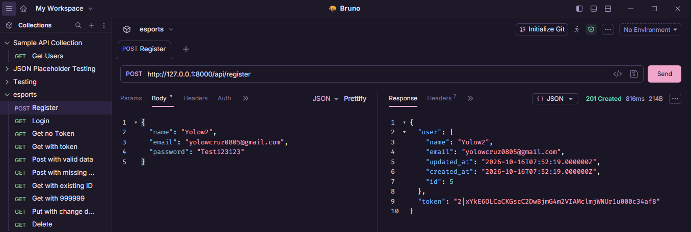
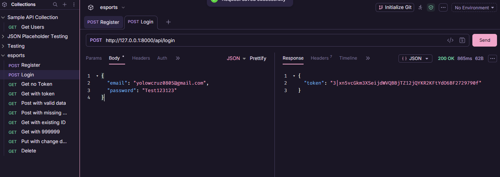
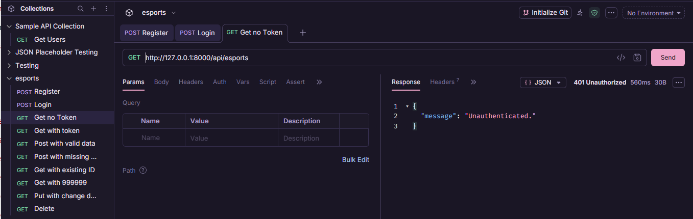
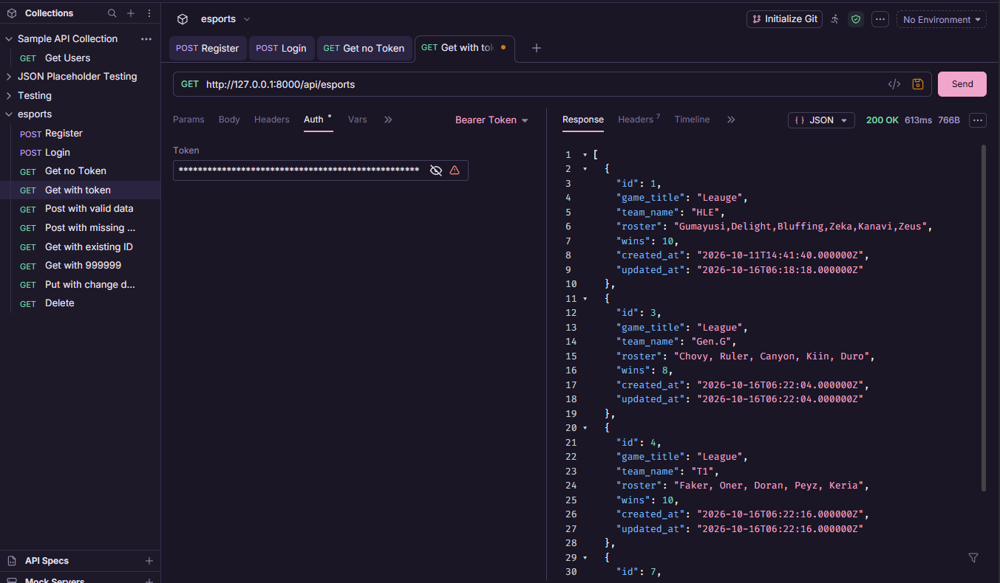
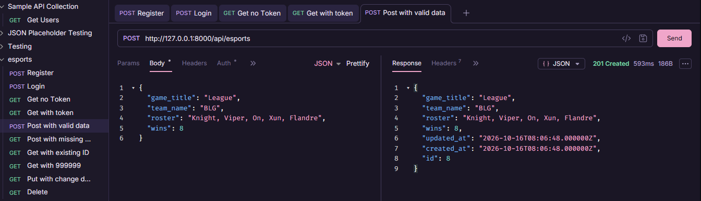
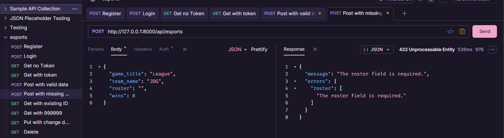
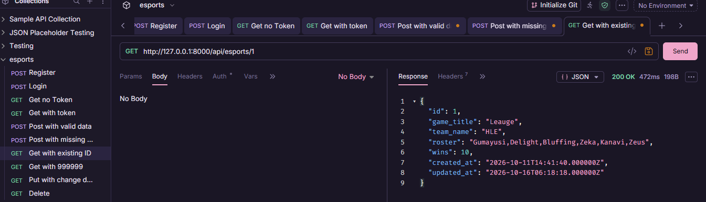
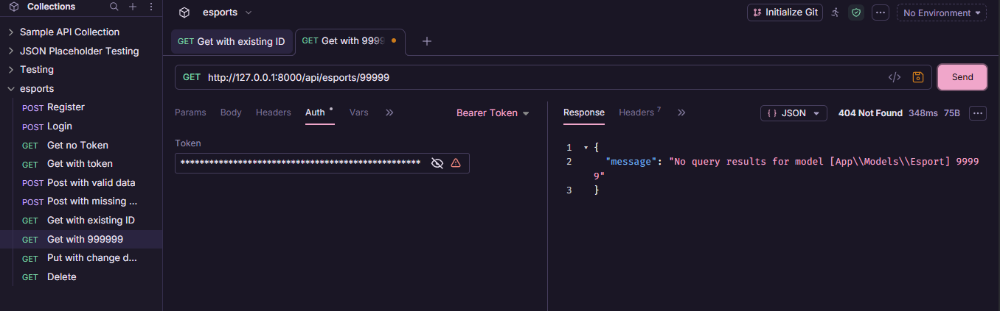
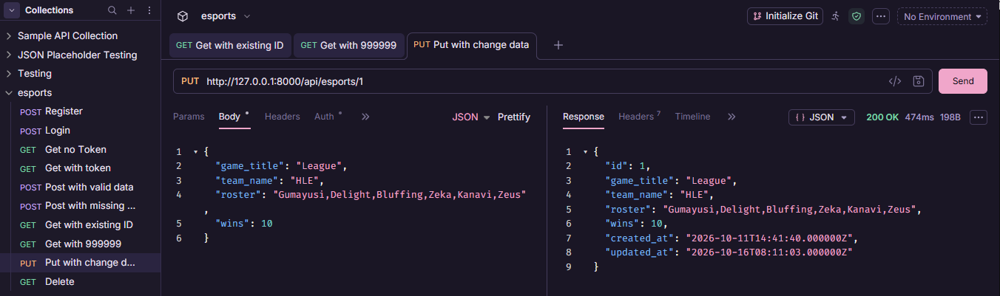
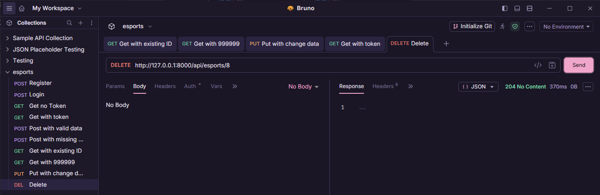

    

<h1 align="center">Esports API</h1>

### By Amadeo Yhulo D. Cruz VI
### Section: IT3E
### Resource Used: Esports

<h2>1. Project Information</h2>

This API manages esports team records with game_title, team_name, roster, and wins fields.

<h2>2. Setup Instructions</h2>

<strong>Prerequisites:</strong> PHP, Composer, Git, and PHP SQLite extensions pdo_sqlite</code> and sqlite3.

<h3>Step 1 - Clone the repository</h3>
git clone https://github.com/godkopi/cit3102-m5-esports.git
cd cit3102-m5-esports

<h3>Step 2 - Install PHP dependencies</h3>

composer install
<h3>Step 3 - Create the environment file and application key</h3>

Windows PowerShell:
Copy-Item .env.example .env
php artisan key:generate

<h3>Step 4 - Run migrations</h3>

php artisan migrate

<h3>Step 5 - Start the development server </h3>

php artisan serve

<h2>3. API Routes</h2>

The Esports API contains nine routes. Public routes do not
require authentication, while protected routes require a
Laravel Sanctum Bearer token.

<table>
  <thead>
    <tr>
      <th>HTTP Request</th>
      <th>Path</th>
      <th>What It Does</th>
      <th>Token Required</th>
    </tr>
  </thead>
  <tbody>
    <tr>
      <td>POST</td>
      <td><code>/api/register</code></td>
      <td>Registers a new user and returns a token</td>
      <td>No</td>
    </tr>
    <tr>
      <td>POST</td>
      <td><code>/api/login</code></td>
      <td>Authenticates a user and returns a token</td>
      <td>No</td>
    </tr>
    <tr>
      <td>POST</td>
      <td><code>/api/logout</code></td>
      <td>Revokes the current authentication token</td>
      <td>Yes</td>
    </tr>
    <tr>
      <td>GET</td>
      <td><code>/api/me</code></td>
      <td>Returns the authenticated user's information</td>
      <td>Yes</td>
    </tr>
    <tr>
      <td>GET</td>
      <td><code>/api/esports</code></td>
      <td>Lists esports records with optional filters</td>
      <td>Yes</td>
    </tr>
    <tr>
      <td>POST</td>
      <td><code>/api/esports</code></td>
      <td>Creates a new esports record</td>
      <td>Yes</td>
    </tr>
    <tr>
      <td>GET</td>
      <td><code>/api/esports/{esport}</code></td>
      <td>Retrieves one esports record by ID</td>
      <td>Yes</td>
    </tr>
    <tr>
      <td>PUT</td>
      <td><code>/api/esports/{esport}</code></td>
      <td>Updates an existing esports record</td>
      <td>Yes</td>
    </tr>
    <tr>
      <td>DELETE</td>
      <td><code>/api/esports/{esport}</code></td>
      <td>Deletes an esports record</td>
      <td>Yes</td>
    </tr>
  </tbody>
</table>

<h2>4. 10 Screenshots</h2>

### Test 1: Registration — 201 Created

### Test 2: Login — 200 OK

### Test 3: Unauthorized Access — 401 Unauthorized

### Test 4: Authorized Access — 200 OK

### Test 5: Create Esports Record — 201 Created

### Test 6: Validation Error — 422 Unprocessable Entity

### Test 7: Retrieve Esports Record — 200 OK

### Test 8: Record Not Found — 404 Not Found

### Test 9: Update Esports Record — 200 OK

### Test 10: Delete Esports Record — 204 No Content

<h2>5. Why does DELETE return 204 and not 200?</h2>

A <b>204</b> is returned because the content is deleted, no content is displayed and nothing to return. Unlike code <b>200</b>, it returns the data, json, and body. That is why the code <b>204</b> is the appropriate to use in Delete operations.

